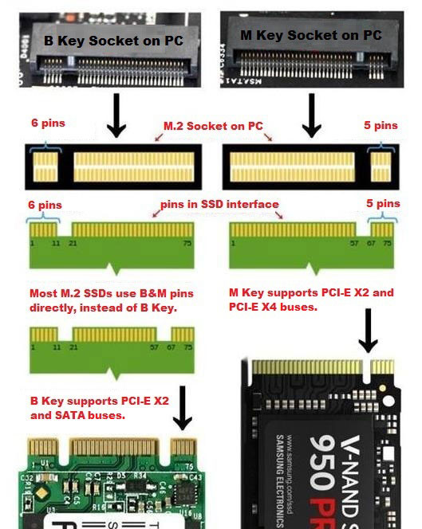
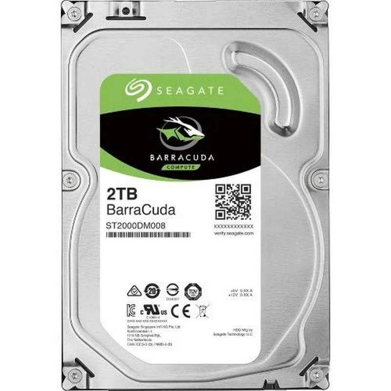
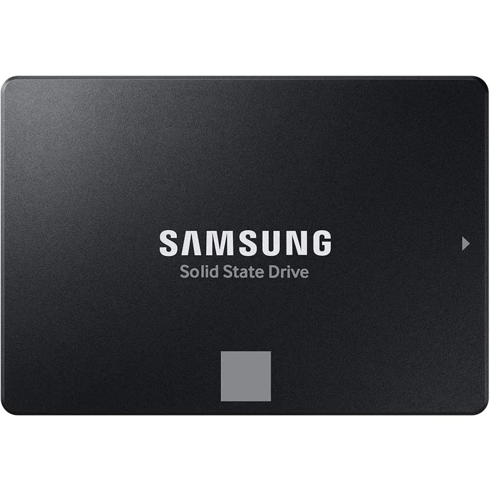
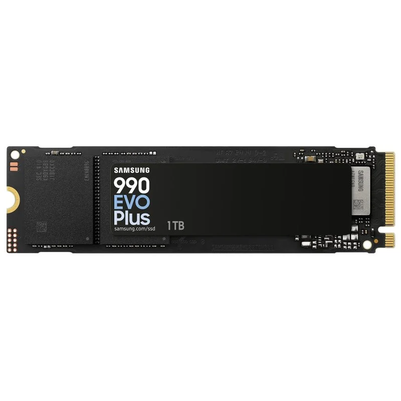

# P2.1 Computer Hardware presentations 

> **Area name:** Storage Devices (HDD / SSD / NVMe)

> **author:** Bryan L. Tarazona R.

## Table of Contents

- [Introduction](#introduction)

- [Main Functions](#main-functions)
   
    - [How It Works](#how-it-works)
        - [HDD](#hdd-hard-disk-drive)
        - [SSD](#ssd-solid-state-drive)
    - [Types](#there-are-3-types)

- [Key Specifications](#key-specifications)

- [Real-World Examples](#real-world-examples)

    - [HDD](#barracuda-35-2tb-sata-3--seagate)
    - [SSD](#sata-ssd-870-evo-1-tb---samsung)
    - [M.2](#nvme-ssd-990-evo-plus-1-tb---samsung)

- [References](#references)

- [Kahoot Quiz](#kahoot-quiz)

# Introduction

### What is a Storage Devises?

Storage devices are hardware components used to store data, programs, and the operating system on a computer. Their main role is to save information permanently, even when the computer is turned off.

There rol is **storage information** depense of the tipe (HDD/SDD/NVMe) do it the one or the other way, this three devises are the most used. every one know this devises or at least we just heard this names.

# Main functions 

There are three common types of storage technologies: HDD, SSD, and NVMe SSD. 

The three devices have the same objective, storage information store data permanently (operating system, programs, documents, photos, etc.) and you don't have to care if you turn off your computer, that stored data don’t disappear, for example, the RAM when you turn off you PC loss al the informacion than you have there… this calcification have a name→ volatile memory ( RAM ) and non volatile memory (HDD,SDD,NVMe SSD)

## How It Works

There are several types of storage, and each one saves information in a different way:

### HDD (Hard Disk Drive):
stores data on spinning magnetic platters. A read/write head moves over them to read or write data. It is cheap and offers large capacity, but it is slower and more sensitive to shocks because it has moving parts.

### SSD (Solid-State Drive): 
uses NAND flash memory chips with no moving parts. It is much faster, quieter, and more durable. It can connect through SATA.for the fastest models-> 

- NVMe (PCIe): this are two different things working together, ins this case:
- PCIe (PCI Express): is a high-speed connection, between the SSD and the CPU but depends on the motherboard type , using lanes. These lanes send information in both directions and only 1 lane is a group of wires. SSD usually used 4 lanes (write X4) so the download speed is like ~3,500 to 14,000 MB/s.

**Others:** USB drives, SD cards, optical media, and cloud storage, mostly used for backups and data transport.
### There are 3 types:

- **B-key:** Supports SATA and PCIe x2.
- **M-key:** Supports PCIe x4 (typically NVMe).
- **B+M key:** Can support both SATA and PCIe, but is limited by the host slot.

**NVMe (Non-Volatile Memory Express)** is the communication protocol, the “language” the SSD and the system use to talk over that highway. It was designed specifically for flash memory. 

# Key Specifications

## Comparison table

#### Technical Characteristics of Storage Devices

| Characteristic | HDD | SSD (SATA) | NVMe SSD |
|---|---|---|---|
| **Technology** | Magnetic platters | NAND flash | NAND flash |
| **Sequential speed** | ~150-285 MB/s | ~500-560 MB/s | ~3,500-7,000 MB/s (PCIe 3.0/4.0); up to ~14,500 MB/s (PCIe 5.0) |
| **Access latency** | ~5-10 ms | ~0.05-0.1 ms | ~0.01-0.02 ms |
| **Random operations (IOPS)** | ~75-200 | ~50,000-100,000 | ~500,000-1,500,000+ |
| **Typical capacity** | 500 GB - 24 TB | 120 GB - 4 TB | 250 GB - 4 TB |
| **Interface** | SATA III (6 Gb/s) | SATA III (6 Gb/s) | PCIe x4 (NVMe protocol) |
| **Form factor** | 3.5" or 2.5" | 2.5" (also M.2 SATA) | M.2 (also PCIe card, U.2) |
| **Power consumption (active)** | ~6-12 W (3.5"), ~2-3 W (2.5") | ~2-4 W | ~5-10 W (up to ~11.5 W on PCIe 5.0) |
| **Noise** | Audible (spinning, head movement) | Silent | Silent |
| **Shock resistance** | Low (moving parts) | High | High |
| **Compatibility** | Almost any computer | Almost any computer | Needs an M.2/PCIe slot with NVMe support and UEFI boot support |
| **Price per GB** | Lowest | Medium to high* | Medium to high* |

In October 2026, a 1 TB SATA SSD (Samsung 870 EVO, ~299.80 €) cost more than a 1 TB NVMe SSD (Samsung 990 EVO Plus, ~222.20 €) on PcComponentes. (checked 23/10/2026).

# Real-World Examples

###  BarraCuda 3.5" 2TB SATA 3 — Seagate

- key specs:
    - Storage capacity: 2 TB
    - Form factor: 3.5" / SATA III (6 Gb/s)
    - Speed: 7,200 RPM / 256 MB
    - Weight: 415 g
- Price (checked on 2026-10-28):149.95 €

  [Store page (PcComponentes)](https://www.pccomponentes.com/disco-duro-seagate-barracuda-3-5-2tb-sata-3)

###  SATA SSD 870 EVO 1 TB - Samsung

- key specs: 
    - Storage capacity: 1 TB
    - Form factor: SSD: 2.5"
    - Speed: 560 / 530 MB/s
    - Weight: 86 g
- price (checked on 2026-10-28): 294.99€

[Store page (PcComponetes)](https://www.pccomponentes.com/disco-duro-samsung-870-evo-ssd-2-5-1tb-sata3-negro)

###  NVMe SSD 990 EVO Plus 1 TB - Samsung

 - key specs: 
    - Storage capacity: 1 TB
    - Form factor: M.2 2280 / PCIe 4.0 x4 or PCIe 5.0 x2 (NVMe 2.0)
    - Speed: 7,150 / 6,300 MB/s
    - Random read / write: 850,000 / 1,350,000 IOPS
- price (checked on 2026-10-28): 229.56€

[Store page (PcComponetes)](https://www.pccomponentes.com/disco-duro-samsung-990-evo-plus-1tb-disco-ssd-7150mb-s-nvme-pcie-4-0-nvme-2-0-nand)

#  References

[Hard disk drive (HDD) versus Solid-state drive](https://www.ibm.com/think/topics/hard-disk-drive-vs-solid-state-drive)

[What is a Solid-State Drive (SSD)](https://hitachivantara.com/en-in/insights/faq/what-is-solid-state-drive.html)

[NVMe vs M.2](https://www.redhat.com/en/blog/nvme-vs-m2)

[NVMe](https://macktez.com/glossary/nvme)

# Kahoot Quiz
[**TIME TO KAHOOT**](https://play.kahoot.it/v2/?quizId=a331de91-6a52-423e-9a97-443962d542d7&hostId=f1ff2667-3a1a-45e0-8374-bc1284f61f6b)

